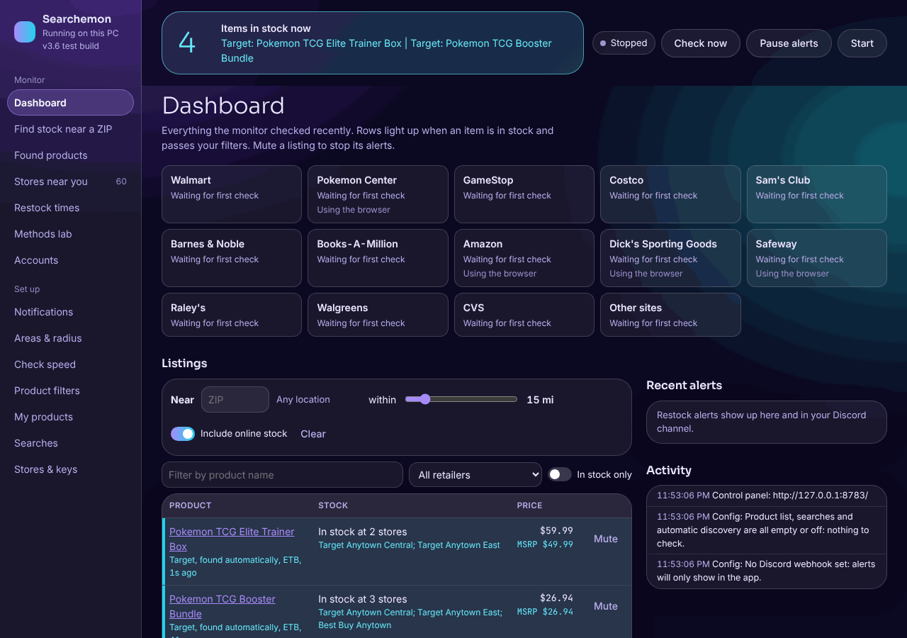
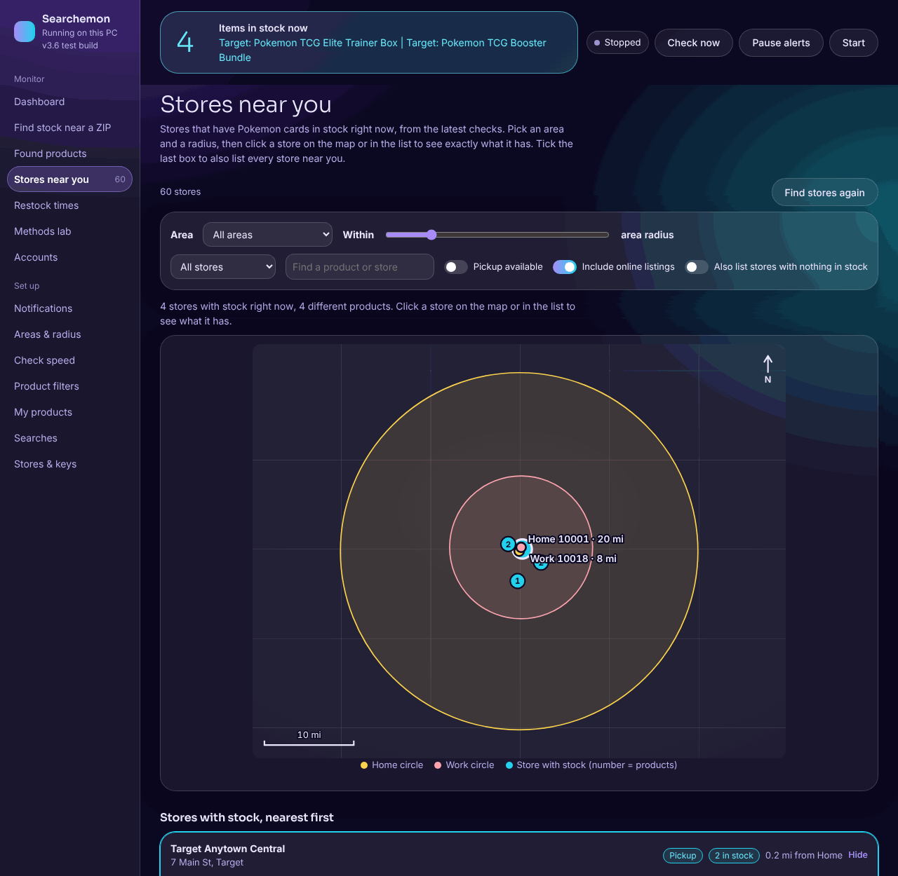
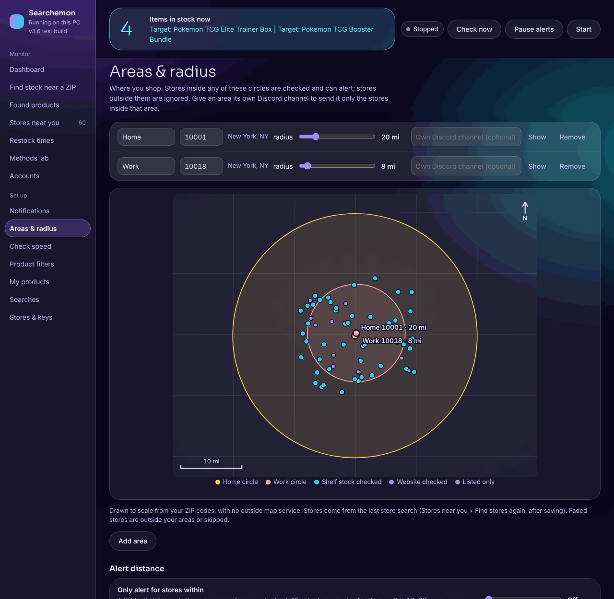
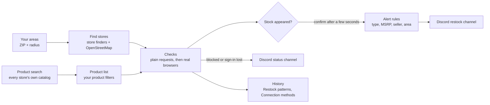

# Searchemon

**A Windows Pokemon TCG restock monitor that runs quietly on your own PC, finds products and nearby
stores by itself, and tells your Discord when something is really in stock.**

No subscription, no cloud service, no account with anyone. Checks run from your computer while the app is
open, your settings stay in a file next to the app, and the control panel only answers on your PC.

> This is the **stable release** (v4.0). Newer test builds live on the `test` branch.
> See [Versions and branches](#versions-and-branches).



## Highlights

- **Finds the products for you.** Target, Best Buy, Walmart and Kroger are searched every few hours, and since v3.5 so are
  CVS, GameStop, Costco, Sam's Club, Walgreens, Barnes & Noble, Books-A-Million and Safeway. Products found at one store are looked up
  at the others by UPC and by name. You do not paste links first. Stores whose search results are built by script (Costco, CVS,
  Safeway, Walgreens, Barnes & Noble) are searched in a real browser that waits for the results; GameStop's newest Pokemon listings
  are read from its category page; when Target refuses its data search, its normal search page is read instead.
- **Shows stock by store, not just a list of stores.** The Stores with stock page lists only the stores that have something in stock
  right now, nearest first, with a map. Pick an area, drag the radius, click a store to see what it has.
- **Alerts you can trust.** A restock has to be a sealed card product of a type you want, sold by the store itself, at or near MSRP,
  inside one of your areas, and still there on a second look a few seconds later.
- **Learns when your stores restock.** A week grid shows the likeliest windows, and the monitor checks twice as often then.
- **Works with bot protection instead of fighting it.** It slows down when a store pushes back, rotates real browsers with
  their own cookies, and asks you only when a person is truly needed.
- **A second Discord channel for problems.** Sign in lost, a store blocking, a check that needs you: all of it goes to a status
  channel, so your restock channel stays for restocks.
- **Looks good.** Dark and light themes in the desktop window, and a "Glass Aurora" control panel that fits any window size, with
  its own fonts and maps (no outside requests).

## Screenshots

| Stock by store | Your areas on a map |
|---|---|
|  |  |

The screenshots use made-up stores and products.

## How it works



## Setup (PowerShell)

1. Install Python 3.13: `winget install -e --id Python.Python.3.13`, or from python.org (tick "Add python.exe to PATH").
   Versions 3.11 to 3.14 work; brand-new ones such as 3.15 fail to install the packages. Setup picks a working version if you have several.
2. Open PowerShell, go into this folder, then run setup:

   ```powershell
   cd "$HOME\Documents\poke-restock"
   powershell -ExecutionPolicy Bypass -File .\setup.ps1
   ```

3. Start it (step 4), open the control panel, then:
   - Discord alerts: paste your channel's webhook URL
     (Server Settings > Integrations > Webhooks > New Webhook > Copy Webhook URL). Optional: a second webhook for the status channel
   - My areas: your home ZIP and a radius
   - optional: a free Best Buy API key and a free Kroger client ID and secret
4. Start it:

   ```powershell
   .\run.ps1
   ```

   Click **Send test message** (Discord alerts) to confirm the channel gets a message.

Optional: `.\add-to-startup.ps1` opens it when you sign in, and `.\build-exe.ps1` builds a standalone `PokeRestock.exe`
(it checks itself before it is zipped).

## The control panel

While the app is open, a control panel runs at **http://127.0.0.1:8765**. The desktop window leads with an
**Open control panel** button, because the panel is the fuller view.

The menu has seven sections. Sections with more than one page show tabs at the top.

| Section | What is there |
|---|---|
| Home | What is in stock right now (with price against MSRP and where), whether each store is checking normally, every listing being watched, and recent alerts. A short Getting started list shows until Discord, your area and your stores are set |
| Stock near me | **Stores with stock**: a map and list of stores with something in stock, filtered by area and radius. **Scan a ZIP**: a one-off scan for any ZIP and radius |
| Products | **Found for you**: what the app found at each store by itself. **Your own links**, **Keyword searches**, and **Prices & filters** (product types and MSRP caps) |
| Discord alerts | The webhook, a test message, and what gets posted. Separate channels, pings and the status channel are under More options |
| My areas | Your ZIP codes and radius, on a map that updates as you type |
| Stores | **Stores & keys** (switch stores on or off; each store's options are tucked away until needed), **How often**, and **Sign-ins** |
| Advanced | **Restock patterns** and **Connection methods** (which way of loading pages lasts longest before a store pushes back) |

It fits narrow windows (the side menu becomes a tab bar), wide tables scroll inside their box, and if the app is closed the page
says so and reconnects by itself when it is back. To use it from your phone on home Wi-Fi, turn on **Phone access** under
Stores > Stores & keys, set a PIN, and restart the app.

## Stock by store


- **Area**: one area or all of them. The map zooms to what you pick.
- **Radius**: a slider that can go past the area's own radius.
- **Filters**: store or chain, a product or store search, pickup available, online listings, and a switch to also list every store
  with nothing in stock.
- Each dot is a store with stock and its number is how many products it has. Click a dot or a card to see each product, its price
  and count, a link, and a flag when the price is over MSRP.

## When stores push back

Big retailers run bot protection, and a monitor that ignores it gets blocked for longer and longer. This one works with it instead:

1. **Recognizes the block.** It tells a rate limit from a JavaScript check from a CAPTCHA, and names the vendor (Akamai,
   PerimeterX, Imperva, Cloudflare, DataDome) in the log.
2. **Slows down on its own.** Each block doubles that store's wait (up to 8x) and it eases back after clean checks.
3. **Switches to a real browser.** Once plain requests are refused, checks for that store move to an Edge or Chrome window kept off
   screen, with its own profile, loading pages the way you would.
4. **Rotates browsers.** Blocks follow a browser session's cookies, not your connection, so the app runs several profiles and rests
   a blocked one while the others carry on.
5. **Uses your own Chrome when a store needs it.** CVS, Sam's Club, GameStop and Dick's refuse automated browsers but accept a normal
   one. The app starts a separate Chrome (minimized, its own profile, DevTools on this PC only) the first time one of them needs it.
   Turn that off with `browser.auto_start_own_chrome: false`.
6. **Asks you when a person is needed.** If a store wants a press-and-hold or puzzle, the browser window comes on screen, you get a
   Windows notification and a banner, and checks for that store wait until you finish it.
7. **Cleans up bad cookies.** Stores > Sign-ins has **Clear bot-check cookies** and **Reset profile** for when a browser earned a bad
   reputation, in both the control panel and the desktop window.

**Advanced > Connection methods** measures all of this. It shows checks per block for every method, a side-by-side test of the same page through every
method, trial methods that switch themselves off when they fail, and an A/B test of the app's own features so you can see whether
they help. The trust report rates each store Reliable, Flaky or Blocked from the app's own recent checks.

**What it deliberately does not do:** fake its browser fingerprint, hide that it is automated, solve or pay for CAPTCHA solving, or
rotate proxies to dodge bans. Those break the stores' terms, get accounts flagged, and are exactly what scalper bots do. Polite
pacing plus a real browser plus you, once in a while, holds up better over time.

## Know when your stores restock

Every restock the monitor sees while running is logged per store, day and hour (`data\history.jsonl`). **Restock patterns** turns that
into a week grid and lists the most likely windows, for example "Tue 7 AM to 9 AM" at your nearest Target. With `learn_from_history`
on, the monitor checks twice as often during those hours, and a newly found sibling product gets extra attention for a while after
one restocks. Alerts also say whether a store has **order pickup**, so you can buy online and collect instead of hoping the shelf
still has it.

## Product types and alerts

Alerts follow your **Prices & filters**: each product type (Elite Trainer Box, Booster Bundle, tin, collection box, and so on) can be
switched on or off for alerts, with its own MSRP cap. An alert fires when stock appears that was not there on the last check, only if
the listing is a sealed card product of a wanted type, sold by the store itself (not a third-party seller), priced at or under its cap
plus wiggle room, at a store inside one of your areas, and still there on a second look. The same item and store will not re-alert
within the quiet period.

## Store coverage

| Store | Online | Shelf stock near you | Needs |
|---|---|---|---|
| Target | yes | units per store, pickup | nothing |
| Best Buy | yes | stores with stock, pickup | free API key |
| Kroger family | no | high/low per store, curbside | free client ID and secret |
| Walmart | yes | pickup at your chosen store | optional: set store in the checking browser |
| CVS | yes, finds products by itself | shelf counts per store | your own Chrome (started for you) |
| GameStop, Costco, Sam's Club, Barnes & Noble, Books-A-Million | yes, find products by themselves | GameStop only | nothing for search; links still work |
| Walgreens | yes, finds products by itself | no | nothing |
| Safeway / Albertsons | yes, finds products by itself | for your chosen store | set store in the checking browser |
| Pokemon Center | yes, plus queue alert | no | product links |
| Amazon | sold by Amazon only | no | product links |
| Dick's Sporting Goods | yes, found automatically | no | nothing (uses the browser) |
| Raley's | online listings (untested) | no | product links |
| Any other store | by link | no | product links |

Store searches read each site's own pages, so a site redesign can break one. Turn on "Save raw responses", run `app.py --once`,
and the raw responses land in `data\debug` for fixing.

## Privacy

- The control panel answers only on this PC. Its fonts and maps are served by the app itself, with no outside requests.
- The app talks to the stores you switch on, your Discord webhook, OpenStreetMap for store locations, and GitHub when you run
  `update.ps1`. It also reads two public lists, which you can switch off under Products > Found for you: new posts on
  r/PokemonTCGDeals every 5 minutes (community restock tips) and the Pokemon set list on tcgcsv.com once a day (newest set
  names for store searches). Both are plain reads with no account; nothing about you is sent. There is no telemetry.
- Links the app produces have tracking parameters removed and open with no referrer.
- `config.yaml` (your webhooks and keys) and `data\` stay on your PC and are in `.gitignore`. Never paste a webhook URL into a file
  that gets committed.
- The checking browsers use their own profiles, separate from your everyday Edge and Chrome.
- With phone access on, the panel needs your PIN, and an address that guesses wrong 8 times in 10 minutes is refused for 10 minutes.
- Troubleshooting copies of store pages in `data\debug` are deleted after 14 days (at most 150 are kept).

## Runs while you use the PC

Browsers stay off screen and never take focus (sign-in is the only time one comes forward, and only when you ask). The app runs at
below-normal priority so games and calls get the CPU first (`power: low_priority`). If your PC sleeps when idle and you want checks to
carry on, set `power: keep_awake: true`. Closing the app hides the window at once and closes every browser together.

## Built to keep running

- **One copy at a time.** Starting the app again from the same folder offers its control panel instead of running a second copy,
  which would post every alert twice.
- **Alerts are never lost to a hiccup.** A Wi-Fi blip or a Discord outage is retried; if an alert still cannot be sent, the next
  check tries again, and a webhook that keeps failing is given up on after a few tries instead of retrying forever.
- **Saving settings does not re-send alerts** for stock the app already told you about.
- **Windows file locks are ridden out.** Antivirus, the search indexer or OneDrive briefly locking a file no longer stops a store's
  checks; saves are retried and a save that still fails is logged and skipped.
- **A typo in `config.yaml` does not stop the app.** A setting that should be a number but is not falls back to its default and is
  listed at startup. If the file cannot be read at all, the window offers the copy saved before your last change.
- **The window never freezes** on one odd update, and a browser that could not start (Edge mid-update, say) is tried again after
  10 minutes.

## Files

- `config.yaml`: your settings and webhooks (private, never share)
- `data\config.backup.yaml`: the previous settings, saved each time the panel saves
- `data\state.json`: last seen stock per item, used to detect changes
- `data\resolved.json`: UPC to store item id lookups
- `data\restock.log`: activity log (rotates at 1 MB)
- `data\history.jsonl` and `data\store-history.json`: restocks and daily check history (kept 180 days)
- `data\catalog.json`: products found automatically
- `data\places.json`: stores near your areas
- `data\block-stats.json`: the block tracker numbers
- `data\browser-profile` and `browser-profiles\<name>`: the checking browsers' own profiles and cookies (delete a folder to reset it)
- `data\my-chrome`: the profile for the Chrome the app starts for CVS, Sam's Club, GameStop and Dick's

## Versions and branches

| Branch | What it is |
|---|---|
| `main` | The stable release (this one, v4.0). Only changes when a build is declared stable |
| `test` | The current test build, if you want to try the newest changes |
| `build/vX.Y`, `release/vN.0` | Frozen copies of single builds, for going back to one |

Stable releases count up whole numbers (v4.0), test builds count up from them (v4.1, v4.2 and so on). [RELEASING.md](RELEASING.md) has the
rules, [CHANGELOG.md](CHANGELOG.md) lists every change with how to test it, [NOTES.md](NOTES.md) is the rolling project memory, and
[RESOURCES.md](RESOURCES.md) lists the tools reviewed and why each was used or not.

```powershell
.\versions.ps1 save "before trying X"   # snapshot of the program files
.\versions.ps1 stable                   # mark the newest snapshot as the known-good one
.\versions.ps1 list
.\versions.ps1 restore                  # back to the stable one (or: restore <name>)
.\update.ps1                            # newest stable release; -Channel test for the newest test build
```

Snapshots hold program files only; `config.yaml` and `data` are never touched.

## Commands

```powershell
.\.venv\Scripts\python.exe app.py                # window
.\.venv\Scripts\python.exe app.py --headless     # console only
.\.venv\Scripts\python.exe app.py --once         # one pass, print results
.\.venv\Scripts\python.exe app.py --test-discord
.\.venv\Scripts\python.exe app.py --abtest       # compare checking methods
.\.venv\Scripts\python.exe app.py --stats        # checks-before-block table
.\.venv\Scripts\python.exe app.py --selftest     # health check of the program and its libraries
.\.venv\Scripts\python.exe -m unittest discover -s tests   # the test suite (269 tests)
```

## Built with

Python 3.13, tkinter for the desktop window, a small built-in web server for the control panel (plain HTML, CSS and JavaScript, no
framework), Playwright and Patchright for the real-browser checks, curl_cffi and h2 for plain requests, and PyInstaller for the exe.
